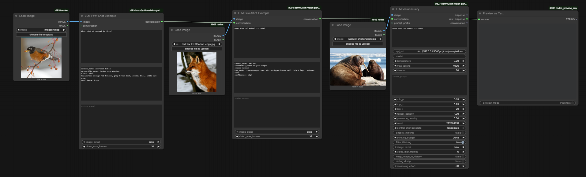
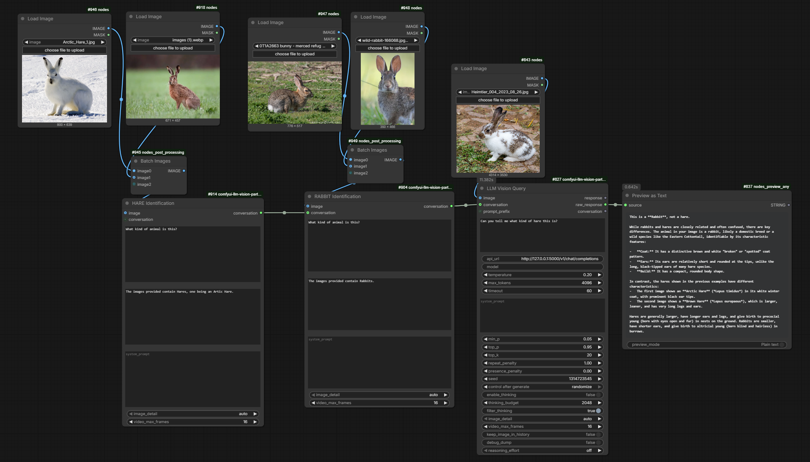
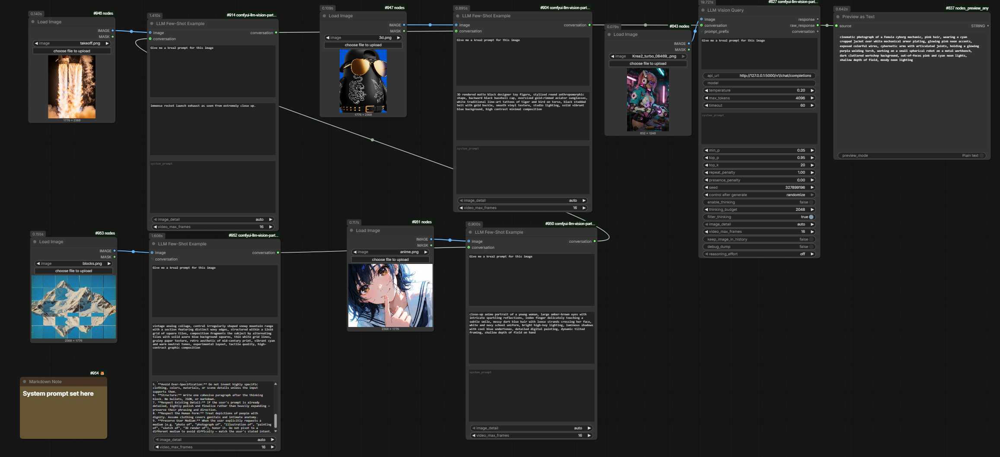
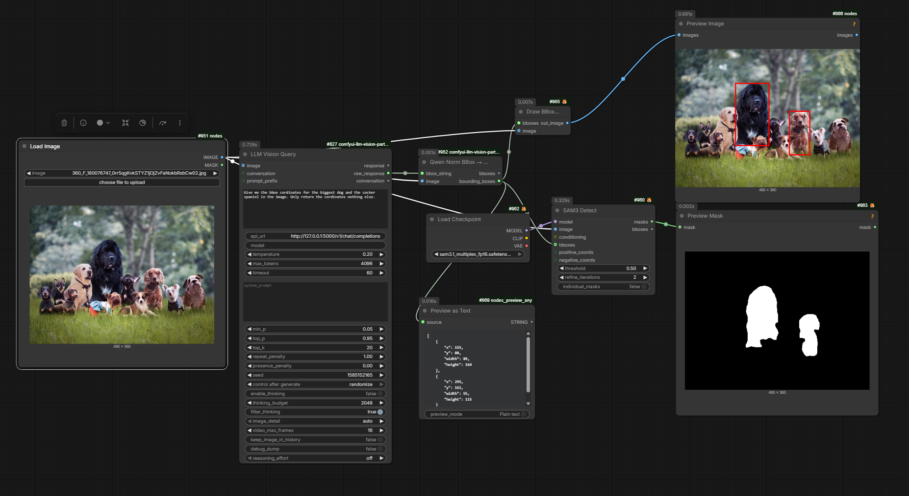

# comfyui-llm-vision-partytricks

A handful of ComfyUI nodes for talking to a **local LLM / vision model** over an OpenAI-compatible API (llama.cpp, vLLM, tabbyAPI, text-generation-webui, LM Studio, Ollama, etc.), with multi-turn conversations and **few-shot image examples**.

## Read this first

I built these for my own workflows and figured I'd share them with the community in case they're useful to someone else.

- **These nodes are 100% vibe coded.** I didn't hand-write them, and I haven't tested them beyond what I use them for.
- **There is no guarantee I will fix anything here.** Issues and PRs are welcome, but I may never get to them. If something breaks for you, forking it is probably your best bet.
- Use at your own risk.

## Install

Pick one:

- **ComfyUI Manager:** *Custom Nodes Manager* → *Install via Git URL* → paste `https://github.com/rahart/comfyui-llm-vision-partytricks`.
- **git** (Linux / macOS / Windows with Git installed):
  ```bash
  cd ComfyUI/custom_nodes
  git clone https://github.com/rahart/comfyui-llm-vision-partytricks
  ```
- **No git (e.g. Windows portable):** on GitHub click *Code* → *Download ZIP*, and extract it into `ComfyUI\custom_nodes\`. For the portable build that's `ComfyUI_windows_portable\ComfyUI\custom_nodes\`. The folder name doesn't matter.

Restart ComfyUI. All the nodes show up under **LLM Vision Party Tricks**.

The only dependencies are `requests`, `numpy` and `Pillow`, which a normal ComfyUI install already has.

You need your own LLM server running separately. These nodes just send it HTTP requests, so the server can be on the same PC or another machine on your network. Point `api_url` at its chat-completions endpoint. Common defaults:

| Server | `api_url` |
|---|---|
| LM Studio | `http://127.0.0.1:1234/v1/chat/completions` |
| Ollama | `http://127.0.0.1:11434/v1/chat/completions` |
| llama.cpp `llama-server` | `http://127.0.0.1:8080/v1/chat/completions` |
| vLLM | `http://127.0.0.1:8000/v1/chat/completions` |
| text-generation-webui / tabbyAPI | `http://127.0.0.1:5000/v1/chat/completions` (the node's default) |

**Platforms:** developed and tested on Linux. Windows and macOS are **untested**. There's no OS-specific code, but nobody has tried it there yet.

## API keys

Most local servers don't need a key, and if you don't set one, none is sent. If your server does need one (vLLM or llama.cpp's server started with `--api-key`, a hosted OpenAI-compatible API, a reverse proxy with auth, etc.), both query nodes send it as an `Authorization: Bearer <key>` header.

There are two ways to provide it.

**1. The `LLM_API_KEY` environment variable (recommended).** Set it in the environment ComfyUI starts in, then restart ComfyUI.

Linux / macOS, in the shell or script that launches ComfyUI:

```bash
export LLM_API_KEY="your-key-here"
python main.py
```

Windows (Command Prompt), or add the `set` line to the top of `run_nvidia_gpu.bat` for the portable build:

```bat
set LLM_API_KEY=your-key-here
python main.py
```

Windows (PowerShell):

```powershell
$env:LLM_API_KEY = "your-key-here"
python main.py
```

systemd service: add `Environment=LLM_API_KEY=your-key-here` under `[Service]` (or point `EnvironmentFile=` at a file only you can read), then `systemctl daemon-reload` and restart the service.

Docker: `docker run -e LLM_API_KEY=your-key-here ...`, or `environment:` in docker-compose.

**2. The `api_key` input socket.** Connect a string to it if different nodes need different keys, for example when one workflow talks to two servers. It overrides `LLM_API_KEY` for that node.

**Why there's no text box for the key:** anything typed into a node's widget gets saved in the workflow JSON and embedded in every PNG ComfyUI saves, so sharing an image or a workflow would share your key. The same applies if you connect a plain String node and type the key into it. That node saves it too. The environment variable never ends up in a workflow or image.

## Nodes

### LLM Query
Sends a text prompt to a chat-completions endpoint.

- `api_url` defaults to `http://127.0.0.1:5000/v1/chat/completions`. See the table under [Install](#install) for common servers.
- `model` can be left blank if your server only serves one model.
- Optional sampling settings: `min_p`, `top_p`, `top_k`, `repeat_penalty`, `presence_penalty`, `seed`. Set them to `-1` or their neutral value to keep your server's defaults.
- Thinking controls: `enable_thinking`, `thinking_budget`, `reasoning_effort` and `filter_thinking`. The last one strips `<think>…</think>` blocks and similar tags out of `response`, while `raw_response` keeps everything.
- `prompt_prefix` is an input socket that gets put in front of the prompt.
- `api_key` is an optional input socket for servers that need a key. See [API keys](#api-keys).
- `debug_dump` writes the exact outgoing request to `output/llm_debug/last_payload.json`. Image data is shortened so the file stays readable.
- Outputs: `response`, `raw_response` and `conversation`.

### LLM Vision Query
Same as LLM Query, plus an `image` input. You can pass a single image or a whole batch, and video frames work as a batch. Batches larger than `video_max_frames` are sampled evenly.

- `image_detail`: `auto` / `low` / `high`.
- `keep_image_in_history`: off by default, so the outgoing `conversation` only holds a text note where the images were. That keeps the conversation small and safe to pass to a text-only model further down the graph.

### LLM Few-Shot Example
Adds a worked example to a conversation **without calling the model**. You give it an image (optional), a question, and the answer you *want*. Chain several of these into an LLM Vision Query and the model treats your written answers as its own earlier replies, so it copies their format and style.

This is the main "party trick": show the model 2–3 images with the exact kind of answer you want, then ask about a new image.

### LLM Conversation → Text
Turns a `conversation` into readable text you can view in a Show Text node, which helps when you're debugging what the model actually saw.

### LLM Save Prompt Log
Appends text, with an optional timestamp and label, to a log file in ComfyUI's `output` folder. Use it to keep prompts or responses you liked after the run is over.

### Qwen Norm BBox → SAM3
Parses `x1,y1,x2,y2` boxes in Qwen-VL's 0–1000 normalized coordinates and turns them into pixel boxes. It finds any four comma-separated numbers in the text, so bare lines, `[x1, y1, x2, y2]` and Qwen's `{"bbox_2d": [...], "label": "..."}` JSON all work. Boxes smaller than 4px are dropped. There are two outputs with the same boxes in two formats:

- `bounding_boxes` (`BOUNDING_BOX`): connect to core ComfyUI's **SAM3 Detect** `bboxes` input.
- `bboxes` (`BBOX`): connect to [comfyui-easy-sam3](https://github.com/yolain/ComfyUI-Easy-Sam3)'s **Sam3 Image Segmentation** and other nodes that take `(x1, y1, x2, y2)` tuples.

## Example workflows

All of these also show up in ComfyUI's **Templates** browser under this pack. No images are included. Load your own into the **Load Image** nodes (each one is titled with what goes in it), and set `api_url` to your server.

### Animal classification: consistent output format

**Workflow:** [`example_workflows/fewshot_animal_id.json`](example_workflows/fewshot_animal_id.json)

[](example_workflows/fewshot_animal_id.json)

Two **LLM Few-Shot Example** nodes (an American robin and a red fox) show the model the answer format you want:

```
common_name: Red Fox
scientific_name: Vulpes vulpes
class: mammal
key_marks: rust-orange coat, white-tipped bushy tail, black legs, pointed ears
confidence: high
```

Then **LLM Vision Query** is asked about a new animal and answers in that same format. Disconnect its `conversation` input and run it again to see what the model gives you without the examples.

### Hare vs rabbit: identification

**Workflow:** [`example_workflows/fewshot_hare_vs_rabbit.json`](example_workflows/fewshot_hare_vs_rabbit.json)

[](example_workflows/fewshot_hare_vs_rabbit.json)

Hares and rabbits look alike, and vision models often mix them up. This one uses **Batch Images** to give each **LLM Few-Shot Example** node several photos at once: two hares (one of them an arctic hare) labeled as hares, and two rabbits labeled as rabbits. Then it asks about a new animal.

Things to try:
- The prompt is deliberately leading ("what kind of **hare** is this?"). Give it a rabbit and see whether the model corrects you.
- **Jackrabbits** are actually hares, and **Belgian Hares** are actually rabbits. Both are good tests of whether the model goes by the animal or by the name.
- Add the visible clues to the example answers (long black-tipped ears and long legs for hares, shorter ears and a compact body for rabbits) to steer the model toward the right features.

Needs a ComfyUI recent enough to include the core **Batch Images** node.

### Image to prompt: system prompt plus examples

**Workflow:** [`example_workflows/fewshot_image_to_prompt.json`](example_workflows/fewshot_image_to_prompt.json)

[](example_workflows/fewshot_image_to_prompt.json)

Turns any image into a text-to-image prompt (written for Krea 2) in your own style. Four **LLM Few-Shot Example** nodes pair images with the prompts that made them: a mid-century collage, an anime portrait, a rocket launch and a 3D designer toy. The first one in the chain also sets the **system prompt** (`system_prompt` on a Few-Shot node puts it at the start of the conversation). Then **LLM Vision Query** writes a prompt for a new image.

The system prompt comes from Krea's [Krea 2 prompting guide](https://github.com/krea-ai/krea-2/blob/main/docs/prompting.md) (Apache-2.0).

Your own generations make the best examples, because you know the exact prompt behind each one, and ComfyUI saves it in the PNG. To close the loop, connect `response` to a **CLIP Text Encode** and generate from it.

### Qwen3-VL boxes to SAM3 masks

**Workflow:** [`example_workflows/qwen_bbox_to_sam3.json`](example_workflows/qwen_bbox_to_sam3.json)

[](example_workflows/qwen_bbox_to_sam3.json)

Describe what you want in plain words ("the biggest dog and the cocker spaniel"), and get a mask for exactly those objects. **LLM Vision Query** asks a Qwen3-VL model for bounding boxes, **Qwen Norm BBox → SAM3** turns its reply into pixel boxes, and core ComfyUI's **SAM3 Detect** segments inside each box. **Draw BBoxes** shows the boxes on the image so you can check them.

- SAM3 Detect uses the `sam3.1_multiplex_fp16.safetensors` checkpoint, loaded with a normal **Load Checkpoint** node from `models/checkpoints`.
- Leave SAM3 Detect's `conditioning` input empty. With only boxes connected, it segments inside each box.
- Use a **Qwen3-VL** model, which gives coordinates on a 0–1000 scale. Qwen2.5-VL gives pixel coordinates, which this node would scale wrong.

## Conversations

Every query node has an optional `conversation` input and a `conversation` output, so you can chain them into a multi-turn chat inside one workflow. A `system_prompt` on a later node replaces the system prompt at the start of the incoming conversation, which lets you refine it partway through a chain.

The conversation only exists during that run. Use **LLM Save Prompt Log** if you want to keep anything.

## Notes

- Requests are streamed, so ComfyUI's cancel button actually stops generation on the server (llama.cpp and vLLM stop when the client disconnects).
- Server error messages are passed straight through as node errors.
- `debug_dump` and the prompt log write your prompts to disk in plain text.

## License

[Apache License 2.0](LICENSE). It's provided "as is", without warranties of any kind, which matches the "no guarantees" above.
